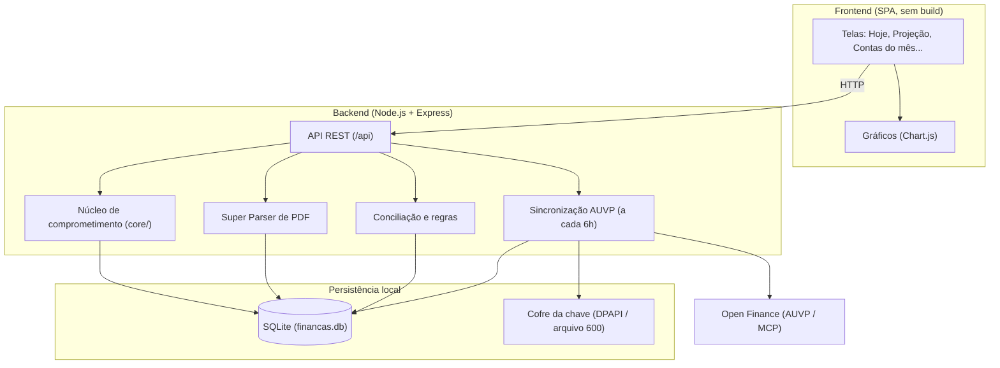

# Leftover Finance — Gestão Financeira Pessoal & Projeção de Sobra Real

<p align="center">
  
</p>

<p align="center">
  <strong>Fluxo de caixa pessoal, faturas de cartão, parcelados e contas fixas num só lugar — para saber quanto realmente sobra, hoje e nos próximos meses.</strong>
</p>

<p align="center">
  
  
  
  
  
  
</p>

---

## Sumário

- [A ideia: "Sobra Real"](#-a-ideia-sobra-real-vs-saldo-ilusório)
- [Instalação rápida](#-instalação-rápida)
- [Primeiros passos (tutorial)](#-primeiros-passos-tutorial)
- [As telas](#-as-telas)
- [Instalação com Docker](#-instalação-com-docker)
- [Configuração (.env)](#️-configuração-env)
- [Backup, atualização e dados](#-backup-atualização-e-dados)
- [Problemas comuns](#-problemas-comuns)
- [Para desenvolvedores](#-para-desenvolvedores)

---

## 📌 A ideia: "Sobra Real" vs "Saldo Ilusório"

Você tem R$ 5.000 na conta hoje, mas na semana que vem vencem R$ 4.000 de fatura e contas fixas. O saldo bancário engana; o que importa é quanto **sobra** depois de tudo que já está comprometido.

O Leftover Finance calcula, mês a mês:

```
Comprometido do mês = Faturas de cartão que vencem no mês
                      (fechada = total oficial; aberta = compras lançadas + parcelas programadas)
                    + Contas fixas e parcelados que vencem no mês
                    + (só no mês corrente) PIX/débitos que já saíram e não pagaram nenhuma conta
─────────────────────────────────────────────────────────────────────────────────
Sobra livre         = Renda do mês − Comprometido
```

Sem chute: **não há previsão de gasto variável**. Só entra o que já foi comprado, contratado ou programado.

---

## 🚀 Instalação rápida

**Pré-requisito:** [Node.js](https://nodejs.org) **22.13 ou mais novo** (recomendado: 24 LTS). O banco usa o `node:sqlite` embutido no Node — não precisa instalar banco de dados.

```bash
git clone https://github.com/EvanderLucena/leftover-finance.git
cd leftover-finance
```

Depois, **um comando**:

| Sistema | Comando |
| --- | --- |
| Windows | dois cliques em `iniciar.cmd` (ou `iniciar.cmd` no terminal) |
| Linux / macOS | `./iniciar.sh` |

O script confere a versão do Node, instala as dependências na primeira vez, cria o `app/.env` a partir do exemplo e sobe o servidor. Abra **http://localhost:4321**.

<details>
<summary>Prefere fazer à mão?</summary>

```bash
cd app
npm ci --omit=dev        # ou: npm install
cp .env.example .env     # opcional
npm start
```

</details>

> O aviso `ExperimentalWarning: SQLite is an experimental feature` no terminal é normal.

---

## 🧭 Primeiros passos (tutorial)

Na primeira abertura o banco (`app/financas.db`) é criado vazio, já no mês corrente. Siga esta ordem — cada passo alimenta o próximo.

### 1. Cadastre suas contas e cartões — *Configurar → Minhas contas e cartões*
O banco novo vem com alguns **exemplos** (Itaú, Nubank, BTG, Mercado Pago). Edite os que você usa, desative os que não usa e crie os seus em **+ Nova Conta / Cartão**.
Para cartão de crédito, informe **dia de fechamento** e **dia de vencimento**: é isso que decide em qual fatura cada compra cai.

### 2. Informe sua renda — *Configurar → Minhas rendas*
Salário e outras rendas líquidas, com o dia em que caem. Toda a projeção é calculada a partir daqui.

### 3. Traga as transações
Escolha uma das fontes (ou as duas):

- **AUVP (Open Finance), recomendado** — em *Configurar → AUVP Financeiro*, cole a **API URL** e a **API Key** da sua conta AUVP, marque **Usar AUVP como fonte**, clique **Salvar** e depois **🔄 Sincronizar agora**.
  A partir daí o app sincroniza sozinho a cada 6 horas enquanto estiver aberto (só leitura na AUVP). Cartões novos são descobertos e o fechamento/vencimento é aprendido das faturas.
- **PDF** — em *Configurar → Importar PDF*, envie faturas do **Nubank, Itaú e Mercado Pago** ou extrato do **Itaú**. Use para períodos que a AUVP não cobre; o que já veio da AUVP não é duplicado.

### 4. Cadastre o que se repete — *Recorrentes*
Aluguel, condomínio, internet, plano de saúde, empréstimos e financiamentos (com número de parcelas). Depois use **Gerar próximo mês** para criar as contas do mês seguinte.

### 5. Acompanhe o mês — *Contas do mês*
Lista tudo que vence no mês. Marque como pago ou clique **⚡ Conciliar com extrato** para o app achar os pagamentos sozinho. Use **+ Novo lançamento** para algo avulso.

### 6. Confirme o que ficou em dúvida — *Reconciliar*
O app sugere qual transação pagou qual conta. Confirme ou recuse; ele aprende os padrões e acerta sozinho nas próximas vezes.

### 7. Leia o resultado — *Hoje* e *Projeção*
Pronto: veja quanto sobra no mês e nos próximos. No **🔮 Simulador: Posso comprar?** teste uma compra parcelada antes de fazê-la.

**Rotina mensal:** sincronize (ou importe os PDFs), confira *Contas do mês* e *Reconciliar*, e no fim do mês clique **Gerar próximo mês** em *Recorrentes*.

---

## 🖥️ As telas

| Tela | Para que serve |
| --- | --- |
| **◎ Hoje** | Caixa até o fim do mês: saldo real das contas, o que ainda sai, o que ainda entra e as faturas abertas de cada cartão. |
| **◉ Projeção** | Comprometimento dos próximos meses, **Alívio das parcelas** (quando cada parcelado acaba e quanto da renda volta), **Comprometimento futuro** e o simulador **Posso comprar?**. |
| **☐ Contas do mês** | Tudo que vence no mês, pago ou em aberto, com conciliação automática pelo extrato. |
| **⏱ Recorrentes** | Contas fixas e parcelados que geram os lançamentos de cada mês. |
| **🔄 Reconciliar** | Sugestões de qual transação pagou qual conta, e os padrões aprendidos. |
| **▤ Transações** | Gastos e entradas dia a dia, top categorias e maiores gastos. |
| **⚙ Configurar** | Contas e cartões, rendas, AUVP e importação de PDF. |

O botão de olho no topo liga o **modo privado** (esconde os valores). A interface funciona no celular.

---

## 🐳 Instalação com Docker

Requer Docker com Docker Compose v2. Os dados ficam em `app/data/` (banco e cofre da chave da AUVP).

### Só na sua máquina (sem HTTPS)

```bash
cd app
docker compose -f docker-compose.local.yml up -d
```

Acesse **http://localhost:4321** (a porta só fica aberta para esta máquina).

### Em servidor, com HTTPS e senha (app + Caddy)

O Caddy emite o certificado HTTPS sozinho e coloca uma tela de usuário/senha na frente do app.

```bash
cd app
cp .env.example .env
# gere o hash da senha:
docker run --rm caddy:2-alpine caddy hash-password --plaintext 'sua-senha'
```

Edite o `.env`:

```env
DOMAIN=financas.seu-dominio.com
AUTH_USER=admin
AUTH_PASS_HASH='$2a$14$...cole.o.hash.aqui'   # mantenha as aspas simples
```

```bash
docker compose up -d
```

O domínio precisa apontar para o servidor e as portas 80 e 443 precisam estar livres. Para testar o Caddy na própria máquina, use `DOMAIN=localhost` e acesse https://localhost (o navegador avisa do certificado local; é esperado).

> **Linux:** o container roda como o usuário `node` (UID 1000). Crie a pasta antes para ela não nascer como root: `mkdir -p data && sudo chown 1000:1000 data`.

---

## ⚙️ Configuração (.env)

Tudo é opcional. O arquivo `app/.env` é lido pelo `npm start` e pelo `docker compose`, e nunca vai para o git. Veja [`app/.env.example`](app/.env.example).

| Variável | Padrão | O que faz |
| --- | --- | --- |
| `PORT` | `4321` | Porta do servidor. |
| `FINANCA_DB` | `app/financas.db` | Caminho do banco SQLite. |
| `AUVP_URL` / `AUVP_KEY` | — | Credenciais da AUVP. **Prefira a tela Configurar.** |
| `AUVP_ATIVO` | — | `1` liga, `0` desliga a AUVP. Se definido, o checkbox da tela deixa de valer. |
| `FINFLOW_COFRE` | ver abaixo | Pasta do cofre da chave da AUVP. |
| `DOMAIN` | `localhost` | Domínio do Caddy (Docker com HTTPS). |
| `AUTH_USER` / `AUTH_PASS_HASH` | `admin` / — | Login do Caddy; o hash é bcrypt, entre aspas simples. |

### Onde fica a chave da AUVP

A API Key digitada na tela **não vai para o banco**. Ela fica num cofre fora da pasta do projeto, para não acabar em backups, cópias do banco ou no git:

- **Windows:** `%APPDATA%\FinFlow\auvp-chave.dpapi`, criptografada com DPAPI (só o seu usuário do Windows nesta máquina abre).
- **Linux/macOS:** `~/.config/finflow/auvp-chave`, com permissão `600`.
- **Docker:** `app/data/cofre/`.

A API nunca devolve a chave para a interface, só se ela existe.

---

## 💾 Backup, atualização e dados

- **Backup:** copie `app/financas.db` (ou `app/data/` no Docker) com o servidor parado. A chave da AUVP não está no banco; se trocar de máquina, cole-a de novo em Configurar.
- **Atualizar:** `git pull`, depois `cd app && npm ci --omit=dev` e reinicie. No Docker: `git pull && docker compose up -d --build`. As migrações do banco rodam sozinhas ao iniciar e só acrescentam.
- **Privacidade:** tudo roda e fica na sua máquina. O único acesso externo é a AUVP, se você ligar. O `.gitignore` bloqueia banco, PDFs, planilhas, caches e `.env`.

---

## 🩺 Problemas comuns

| Sintoma | Solução |
| --- | --- |
| `No such built-in module: node:sqlite` ou erro ao abrir o banco | Node antigo. Instale o 22.13+ (`node -v` para conferir). |
| `EADDRINUSE: address already in use :::4321` | Já há algo na porta 4321 (talvez o próprio app aberto em outra janela). Feche-o ou use `PORT=4322` no `.env`. |
| Caddy não sobe / senha nunca aceita | Hash sem aspas simples no `.env` (o `$` é expandido) ou `AUTH_PASS_HASH` vazio. |
| No Docker (Linux), erro `unable to open database file` | Permissão da pasta `data/`: `sudo chown 1000:1000 data`. |
| Checkbox "Usar AUVP como fonte" não muda nada | `AUVP_ATIVO` está definido no `.env` ou no ambiente; remova a linha. |
| Sincronização da AUVP falha | Confira URL e chave em Configurar. O resultado da última tentativa aparece logo abaixo do botão. |

---

## 🛠️ Para desenvolvedores

### Arquitetura



### Estrutura

```text
leftover-finance/
├── iniciar.cmd / iniciar.sh   # instala na primeira vez e sobe o app
├── README.md
├── LICENSE
└── app/
    ├── server.js              # Express: rotas da API e arquivos estáticos
    ├── db.js                  # schema SQLite, migrações aditivas e dados iniciais
    ├── package.json
    ├── .env.example           # modelo de configuração
    ├── Dockerfile
    ├── docker-compose.yml     # app + Caddy (HTTPS e senha)
    ├── docker-compose.local.yml # só o app, em localhost:4321
    ├── Caddyfile
    ├── core/                  # regras de negócio centrais
    │   ├── comprometido.js    # motor único: faturas, parcelas, renda e sobra
    │   ├── calendario.js      # meses, dias úteis, feriados e data de Brasília
    │   ├── auvp-sync.js       # sincronização com a AUVP (só leitura)
    │   └── segredo.js         # cofre da chave da AUVP
    ├── scripts/               # módulos de apoio
    │   ├── auvp-client.js     # cliente MCP da AUVP (sessão, rate limit, retry)
    │   ├── sync-diario.js     # sincronização automática em segundo plano
    │   ├── super-parser.js    # detecta o banco e lê o PDF
    │   ├── parse-*.js         # parsers de Itaú, Nubank, Mercado Pago e extrato
    │   ├── conciliacao.js     # liga transações às contas do mês
    │   ├── heuristico.js, motor-regras.js, regras-seed.js  # categorização
    │   ├── contas.js, saldos.js, renda-realizada.js, compromisso-mes.js
    │   ├── check-consistencia.js  # confere os painéis entre si após o sync
    │   └── import.js          # importa a planilha legada (npm run import)
    ├── public/                # frontend estático (index.html, app.js, style.css)
    └── test/                  # teste de ouro (npm test)
```

### Comandos

```bash
cd app
npm install     # inclui dependências de desenvolvimento
npm start       # http://localhost:4321
npm test        # teste de ouro
```

O **teste de ouro** confere o sistema contra um retrato real (banco + AUVP + valores conferidos nos apps dos bancos). Esses dados são pessoais e ficam em `app/test/fixtures/`, fora do git; sem eles o teste é pulado.

### Contribuições

Issues e Pull Requests são bem-vindos.

1. Faça um fork
2. Crie uma branch (`git checkout -b feature/nova-funcionalidade`)
3. Commit (`git commit -m 'feat: adiciona nova funcionalidade'`)
4. Push (`git push origin feature/nova-funcionalidade`)
5. Abra um Pull Request

---

## 📄 Licença

Distribuído sob a licença **MIT**. Veja [`LICENSE`](LICENSE).
