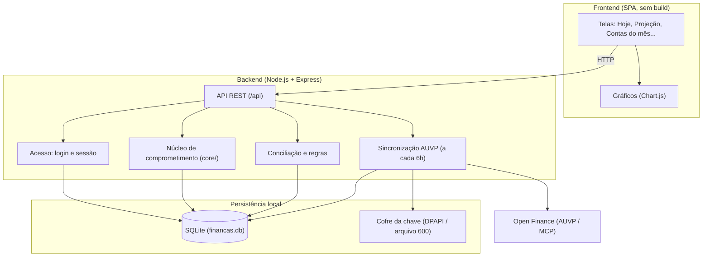

# Leftover Finance — Gestão Financeira Pessoal & Projeção de Sobra Real

<p align="center">
  
</p>

<p align="center">
  <strong>Fluxo de caixa pessoal, faturas de cartão, parcelados e contas fixas num só lugar — para saber quanto realmente sobra, hoje e nos próximos meses.</strong>
</p>

<p align="center">
  
  
  
  
  
  
</p>

---

## Sumário

- [A ideia: "Sobra Real"](#-a-ideia-sobra-real-vs-saldo-ilusório)
- [Instalação rápida](#-instalação-rápida)
- [Primeiros passos (tutorial)](#-primeiros-passos-tutorial)
- [As telas](#-as-telas)
- [Usar no celular](#-usar-no-celular)
- [Instalação com Docker](#-instalação-com-docker)
- [Configuração (.env)](#️-configuração-env)
- [Segurança](#-segurança)
- [Backup, atualização e dados](#-backup-atualização-e-dados)
- [Problemas comuns](#-problemas-comuns)
- [Para desenvolvedores](#-para-desenvolvedores)

---

## 📌 A ideia: "Sobra Real" vs "Saldo Ilusório"

Você tem R$ 5.000 na conta hoje, mas na semana que vem vencem R$ 4.000 de fatura e contas fixas. O saldo bancário engana; o que importa é quanto **sobra** depois de tudo que já está comprometido.

O Leftover Finance calcula, mês a mês:

```
Comprometido do mês = Faturas de cartão que vencem no mês
                      (fechada = total oficial; aberta = compras lançadas + parcelas programadas)
                    + Contas fixas e parcelados que vencem no mês
                    + (só no mês corrente) PIX/débitos que já saíram e não pagaram nenhuma conta
─────────────────────────────────────────────────────────────────────────────────
Sobra livre         = Renda do mês − Comprometido
```

Sem chute: **não há previsão de gasto variável**. Só entra o que já foi comprado, contratado ou programado.

Os dados chegam pela **AUVP** (open finance): você conecta seus bancos e cartões lá, e o app lê contas, cartões, saldos, faturas e transações pelo MCP da AUVP. Funciona com qualquer banco conectado na AUVP; nenhum banco fica fixo no código. A leitura é só de consulta: daqui não sai nenhum pagamento nem transferência.

---

## 🚀 Instalação rápida

> **Projeto pessoal, aberto como está.** Use por sua conta; não há suporte. Fork e ajustes são bem-vindos.

**Você vai precisar de:**

- [Node.js](https://nodejs.org) **22.13 ou mais novo** (recomendado: 24 LTS). O banco usa o `node:sqlite` embutido no Node — não precisa instalar banco de dados.
- Uma conta na **AUVP** com seus bancos e cartões conectados, e a **chave do MCP da AUVP** (começa com `auvp_`).

```bash
git clone https://github.com/EvanderLucena/leftover-finance.git
cd leftover-finance
```

Depois, **um comando**:

| Sistema | Comando |
| --- | --- |
| Windows | dois cliques em `iniciar.cmd` (ou `iniciar.cmd` no terminal) |
| Linux / macOS | `./iniciar.sh` |

O script confere a versão do Node, instala as dependências na primeira vez, cria o `app/.env` a partir do exemplo e sobe o servidor. Abra **http://localhost:4321**.

<details>
<summary>Prefere fazer à mão?</summary>

```bash
cd app
npm ci --omit=dev        # ou: npm install
cp .env.example .env     # opcional
npm start
```

</details>

> O aviso `ExperimentalWarning: SQLite is an experimental feature` no terminal é normal.

---

## 🧭 Primeiros passos (tutorial)

Na primeira abertura o banco (`app/financas.db`) é criado vazio, já no mês corrente, e um **assistente** conduz a configuração. Cada passo alimenta o próximo; dá para voltar a qualquer um.

### 1. Crie seu acesso
Escolha um **usuário e senha**. É uma conta só, guardada no próprio computador. Aberto neste computador, o app cria a conta direto; de outro aparelho, pede o **código de instalação** que aparece no terminal onde o app foi iniciado.

### 2. Conecte a AUVP
Na AUVP, confira se os bancos e cartões que você usa estão conectados e gere a chave do MCP. Cole a chave no assistente e clique **Conectar e buscar meus dados**: o app busca contas, cartões, saldos, faturas e transações.

### 3. Confira contas e cartões
Os cartões chegam com o **dia de fechamento e de vencimento** aprendidos das faturas, e podem errar por um ou dois dias. Confira no app do banco e corrija: é isso que decide em qual fatura cada compra cai.

### 4. Diga quais são as suas rendas
O app separa as entradas que se repetem no histórico e pergunta quais são renda, e de que tipo:

- **Fixa**: o mesmo valor todo mês.
- **Por hora**: valor da hora × horas do mês.
- **Variável**: muda todo mês; o app usa a média dos últimos 3 meses.
- **Eventual**: só conta no mês em que cair.

Cada renda é reconhecida no extrato pelo texto ou pelo valor exato do crédito.

### 5. Cadastre contas fixas e dívidas
Aluguel, condomínio, luz, internet, escola, financiamento, empréstimo. O app sugere os pagamentos que se repetem no histórico; você confirma o que é fixo. **Compra no cartão não se cadastra aqui**: ela já vem na fatura. Cada conta fixa vira uma **recorrente**; o que já foi pago no mês é ligado ao pagamento sozinho.

### 6. Escolha onde vai usar
- **Só neste computador**: o app só abre aqui.
- **Na casa toda**: abre no celular e em outros aparelhos do mesmo Wi-Fi, sempre com usuário e senha. Veja [Usar no celular](#-usar-no-celular).

Dá para trocar depois em **Configurar → Acesso**.

### Depois do assistente

- **Contas do mês**: tudo que vence no mês, pago ou em aberto. Toque numa conta para ver ou trocar o pagamento ligado a ela; **⚡ Conciliar com extrato** procura os pagamentos sozinho; **+ Novo lançamento** cria algo avulso.
- **Reconciliar**: o app sugere qual PIX, boleto ou débito pagou qual conta. Confirme ou recuse; ele aprende os padrões e acerta sozinho nas próximas vezes.
- **Hoje** e **Projeção**: quanto sobra no mês e nos próximos. No **🔮 Simulador: Posso comprar?** teste uma compra parcelada antes de fazê-la.

A AUVP é sincronizada sozinha a cada 6 horas enquanto o app estiver aberto; o botão **Atualizar da AUVP** força na hora.

**Rotina mensal:** confira *Contas do mês* e *Reconciliar*, e no fim do mês clique **Gerar próximo mês** em *Recorrentes* (a dívida parcelada para sozinha na última parcela).

---

## 🖥️ As telas

| Tela | Para que serve |
| --- | --- |
| **◎ Hoje** | Caixa até o fim do mês: saldo real das contas, o que ainda sai, o que ainda entra e as faturas abertas de cada cartão. |
| **◉ Projeção** | Comprometimento dos próximos meses, **Alívio das parcelas** (quando cada parcelado acaba e quanto da renda volta), **Comprometimento futuro** e o simulador **Posso comprar?**. |
| **☐ Contas do mês** | Tudo que vence no mês, pago ou em aberto, com o pagamento ligado a cada conta. |
| **⏱ Recorrentes** | Contas fixas e parcelados que geram as contas de cada mês, e as sugeridas pelo histórico. |
| **⇄ Reconciliar** | Sugestões de qual transação pagou qual conta, e os padrões aprendidos. |
| **▤ Transações** | Gastos e entradas por período, conta e categoria, top categorias e maiores gastos. |
| **⚙ Configurar** | Contas e cartões, rendas, AUVP e acesso (casa toda, senha, sair). |

O botão de olho no topo liga o **modo privado** (esconde os valores).

---

## 📱 Usar no celular

1. Em **Configurar → Acesso**, escolha **Na casa toda**. O app mostra o endereço para abrir no celular (ex.: `http://192.168.0.10:4321`).
2. No Windows, quando o firewall perguntar, permita o Node.js em **Redes privadas**.
3. Abra o endereço no celular, no mesmo Wi-Fi, e entre com seu usuário e senha. O computador precisa estar ligado e com o app aberto.

No celular o menu fica embaixo: **Hoje, Projeção, Contas, Transações** e **Mais** (Recorrentes, Reconciliar, Configurar). As tabelas viram cartões, e um toque numa transação ou recorrente abre a edição.

**De fora de casa:** o app usa HTTP simples, pensado para a rede de casa. **Não abra a porta no roteador.** Use uma VPN como o [Tailscale](https://tailscale.com): instale no computador do app e no celular e abra o endereço do Tailscale na porta 4321.

---

## 🐳 Instalação com Docker

Requer Docker com Docker Compose v2. Os dados ficam em `app/data/` (banco e cofre da chave da AUVP).

### Na casa toda

```bash
cd app
docker compose up -d
docker compose logs app    # mostra o código de instalação
```

Abra `http://IP-DA-MÁQUINA:4321` e crie usuário e senha. Como o acesso não vem do próprio computador do app, a primeira tela pede o **código de instalação** do log. Para o app mostrar o endereço certo para o celular, defina `FINANCA_ENDERECO` no `.env`.

### Só na sua máquina

```bash
cd app
docker compose -f docker-compose.local.yml up -d
```

Acesse **http://localhost:4321** (a porta só fica aberta para esta máquina). O código de instalação aparece em `docker compose -f docker-compose.local.yml logs app`.

> **Linux:** o container roda como o usuário `node` (UID 1000). Crie a pasta antes para ela não nascer como root: `mkdir -p data && sudo chown 1000:1000 data`.

---

## ⚙️ Configuração (.env)

Tudo é opcional. O arquivo `app/.env` é lido pelo `npm start` e pelo `docker compose`, e nunca vai para o git. Veja [`app/.env.example`](app/.env.example).

| Variável | Padrão | O que faz |
| --- | --- | --- |
| `PORT` | `4321` | Porta do servidor (`npm start`). |
| `PORTA` | `4321` | Porta no computador quando roda no Docker. |
| `FINANCA_DB` | `app/financas.db` | Caminho do banco SQLite. |
| `FINANCA_ENDERECO` | — | Endereço que o app mostra para abrir no celular (no Docker o container não sabe o IP da máquina). |
| `FINANCA_HOST` | — | Fixa onde o servidor escuta (o Docker usa `0.0.0.0`). Com ela definida, a escolha em *Configurar → Acesso* deixa de valer. |
| `AUVP_KEY` | — | Chave do MCP da AUVP. **Prefira colar pela tela.** |
| `AUVP_URL` | endereço da AUVP | Endereço do MCP da AUVP (`npm start`). |
| `AUVP_ATIVO` | — | `1` liga, `0` desliga a AUVP (`npm start`). Se definido, o checkbox da tela deixa de valer. |
| `FINFLOW_COFRE` | ver abaixo | Pasta do cofre da chave da AUVP. |

### Onde fica a chave da AUVP

A chave colada na tela **não vai para o banco**. Ela fica num cofre fora da pasta do projeto, para não acabar em backups, cópias do banco ou no git:

- **Windows:** `%APPDATA%\FinFlow\`, criptografada com DPAPI (só o seu usuário do Windows nesta máquina abre).
- **Linux/macOS:** `~/.config/finflow/`, com permissão `600`.
- **Docker:** `app/data/cofre/`.

A API nunca devolve a chave para a interface, só se ela existe.

---

## 🔑 Segurança

- **Senha do app**: guardada só como hash (scrypt). A sessão é um cookie `HttpOnly` de 90 dias; 5 senhas erradas seguidas bloqueiam aquele aparelho por 1 minuto.
- **Chave da AUVP**: no cofre local descrito acima, nunca no banco nem nas respostas da API.
- **Dados financeiros**: ficam no SQLite local, que o `.gitignore` nunca deixa entrar no git.

---

## 💾 Backup, atualização e dados

- **Backup:** copie `app/financas.db` (ou `app/data/` no Docker) com o servidor parado. A chave da AUVP não está no banco; se trocar de máquina, cole-a de novo em Configurar.
- **Atualizar:** `git pull`, depois `cd app && npm ci --omit=dev` e reinicie. No Docker: `git pull && docker compose up -d --build`. As migrações do banco rodam sozinhas ao iniciar e só acrescentam.
- **Esqueceu a senha:** no computador onde o app roda, `npm run nova-senha` na pasta `app`. O acesso é apagado (os dados ficam) e o app pede um novo na próxima vez.
- **Privacidade:** tudo roda e fica na sua máquina. O único acesso externo é a AUVP. O `.gitignore` bloqueia banco, PDFs, planilhas, caches e `.env`.

---

## 🩺 Problemas comuns

| Sintoma | Solução |
| --- | --- |
| `No such built-in module: node:sqlite` ou erro ao abrir o banco | Node antigo. Instale o 22.13+ (`node -v` para conferir). |
| `EADDRINUSE: address already in use :::4321` | Já há algo na porta 4321 (talvez o próprio app aberto em outra janela). Feche-o ou use `PORT=4322` no `.env`. |
| O celular não abre o app | Confira se escolheu **Na casa toda** em *Configurar → Acesso*, se o celular está no mesmo Wi-Fi e se o firewall do Windows liberou o Node.js em redes privadas. |
| A tela de criar acesso pede um código | Você está criando a conta de outro aparelho (ou pelo Docker). O código de instalação aparece no terminal onde o app subiu (`docker compose logs app`). |
| Esqueci a senha | `npm run nova-senha` na pasta `app`, no computador do app. |
| No Docker (Linux), erro `unable to open database file` | Permissão da pasta `data/`: `sudo chown 1000:1000 data`. |
| Checkbox "Usar AUVP como fonte" não muda nada | `AUVP_ATIVO` está definido no `.env` ou no ambiente; remova a linha. |
| Sincronização da AUVP falha | Confira a chave em Configurar. O erro da última tentativa aparece logo abaixo do botão; no limite de chamadas da AUVP o app espera e tenta de novo. |

---

## 🛠️ Para desenvolvedores

### Arquitetura



### Estrutura

```text
leftover-finance/
├── iniciar.cmd / iniciar.sh     # instala na primeira vez e sobe o app
├── README.md
├── LICENSE
└── app/
    ├── server.js                # Express: rotas da API e arquivos estáticos
    ├── db.js                    # schema SQLite e migrações aditivas
    ├── package.json
    ├── .env.example             # modelo de configuração
    ├── Dockerfile
    ├── docker-compose.yml       # app no Docker, aberto na rede de casa
    ├── docker-compose.local.yml # só o app, em localhost:4321
    ├── core/                    # regras de negócio centrais
    │   ├── acesso.js            # usuário e senha, sessão, "só este PC" ou "casa toda"
    │   ├── auvp-sync.js         # contas, cartões, faturas e transações da AUVP (só leitura)
    │   ├── comprometido.js      # motor único: faturas, contas, renda e sobra de cada mês
    │   ├── contas-fixas.js      # contas fixas e dívidas sugeridas pelo histórico
    │   ├── rendas.js            # rendas: reconhecimento, sugestões, média das variáveis
    │   ├── fontes.js            # origem de cada transação (cartão ou conta)
    │   ├── calendario.js        # meses, dias úteis, feriados e data de Brasília
    │   └── segredo.js           # cofre da chave da AUVP
    ├── scripts/                 # módulos de apoio
    │   ├── auvp-client.js       # cliente MCP da AUVP (sessão, limite de chamadas, retry)
    │   ├── sync-diario.js       # sincronização automática em segundo plano
    │   ├── conciliacao.js       # liga pagamentos às contas do mês
    │   ├── motor-regras.js, regras-seed.js  # categorização
    │   ├── contas.js, saldos.js, renda-realizada.js, compromisso-mes.js
    │   ├── check-consistencia.js  # confere os painéis entre si após o sync
    │   └── nova-senha.js        # apaga o acesso (npm run nova-senha)
    ├── public/                  # frontend estático (index.html, entrar.html, app.js, style.css)
    └── test/                    # teste de ouro (npm test)
```

### Comandos

```bash
cd app
npm install     # dependências
npm start       # http://localhost:4321
npm test        # teste de ouro
```

O **teste de ouro** confere o sistema contra um retrato real (banco + AUVP + valores conferidos nos apps dos bancos). Esses dados são pessoais e ficam em `app/test/fixtures/`, fora do git; sem eles o teste é pulado.

### Contribuições

Issues e Pull Requests são bem-vindos.

1. Faça um fork
2. Crie uma branch (`git checkout -b feature/nova-funcionalidade`)
3. Commit (`git commit -m 'feat: adiciona nova funcionalidade'`)
4. Push (`git push origin feature/nova-funcionalidade`)
5. Abra um Pull Request

---

## 📄 Licença

Distribuído sob a licença **MIT**. Veja [`LICENSE`](LICENSE).
