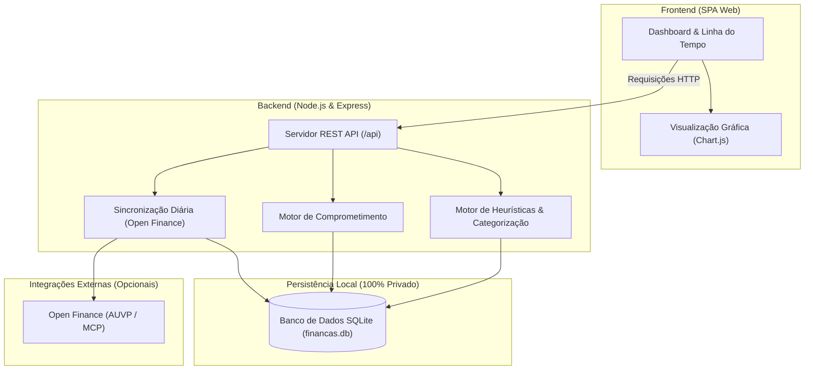

# Leftover Finance — Gestão Financeira Pessoal & Projeção de Sobra Real

<p align="center">
  
</p>

<p align="center">
  <strong>Sistema inteligente de fluxo de caixa, gestão de despesas fixas, antecipação de faturas de cartão de crédito e projeção de liquidez futura.</strong>
</p>

<p align="center">
  
  
  
  
  
  
</p>

---

## 📌 A Filosofia: "Sobra Real" vs "Saldo Ilusório"

A maioria dos aplicativos financeiros tradicionais mostra apenas o seu saldo bancário atual ou um gráfico do que você já gastou no passado. Isso cria uma ilusão de caixa: você tem R$ 5.000 na conta hoje, mas na próxima semana vencem R$ 4.000 em faturas de cartão e contas fixas.

O **Leftover Finance** foca no que realmente importa: **a sua Sobra Real**.
Ele calcula o fluxo de liquidez projetando o mês atual e meses futuros através de 4 camadas:

```
Liquidez Disponível = Saldo em Conta + Rendas Previstas
                     − Faturas de Cartão (correntes e compras parceladas)
                     − Despesas Fixas da Casa (aluguel, condomínio, luz, etc.)
                     − Parcelas Contratadas (empréstimos, financiamentos)
────────────────────────────────────────────────────────────────────────────
Sobra Real Livre     = O valor que você realmente tem disponível para poupar ou investir.
```

---

## 🚀 Funcionalidades Principais

### 1. 📊 Painel de Controle (Command Center)
- **Visão Instantânea de Liquidez:** Saldo real de contas correntes, faturas de cartão fechando/vencendo e previsão de saldo pós-faturas.
- **Card "Para Onde Vai Cada Real":** Distribuição proporcional exata da renda (Faturas de Cartão, Despesas Fixas, Parcelas de Dívidas e Variável) com indicador de pressão orçamentária.
- **Barra de Progresso Temporal do Mês:** Acompanhe o percentual do mês decorrido vs. ritmo de consumo da renda.

### 2. 💳 Inteligência de Faturas & Modelo de Parcelas
- **Identidade Única de Compras:** Compras parceladas existem uma única vez no sistema; a mesma compra vista em várias faturas é unificada sem duplicar valores.
- **Relógio de Faturas em Tempo Real:** Acompanhamento dinâmico de datas de corte (fechamento) e vencimento de cada cartão, aprendidos das faturas da AUVP (e ajustáveis em Configurar).
- **Calendário de Descompressão de Dívidas:** Projeção visual de quando cada parcela contratada termina, permitindo prever a recuperação da renda nos próximos meses.

### 3. 🏦 Open Finance pela AUVP (qualquer banco)
- **Sincronização automática:** contas, cartões, saldos, faturas oficiais e transações vêm do MCP da AUVP. Funciona com qualquer banco conectado lá; nenhum banco fica fixo no código.
- **Contas e cartões descobertos sozinhos:** cada conta ou cartão novo na AUVP aparece em Configurar, com fechamento e vencimento aprendidos das faturas.
- **Rendas cadastradas por você:** salário fixo, por hora ou outra entrada, reconhecida pelo texto ou pelo valor do crédito.
- **Motor de Regras:** categorização e natureza financeira (`gasto`, `transferencia`, `transferencia-propria`, `salario`, `rendimento`, `ignorado`), com a categoria da AUVP quando nenhuma regra casa.

### 5. 🔒 Privacidade Absoluta & Segurança de Chaves
- **100% Local:** Todo o armazenamento reside em um banco SQLite (`financas.db`) gerenciado pelo módulo nativo `node:sqlite`.
- **Zero Vazamento:** Extratos, senhas, planilhas e histórico financeiro são rigorosamente protegidos no `.gitignore`.
- **Chave da AUVP fora do banco:** fica num cofre local (no Windows, criptografada com DPAPI; no Linux/Docker, arquivo só do dono) ou em variável de ambiente, nunca no `financas.db` nem no git.

---

## 🏗️ Arquitetura do Sistema



---

## 📁 Estrutura do Projeto

```text
leftover-finance/
├── .gitignore               # Proteção estrita contra vazamento de dados pessoais
├── LICENSE                  # Licença MIT
├── README.md                # Documentação do projeto
└── app/
    ├── server.js            # Servidor Express & endpoints da API
    ├── db.js                # Inicialização e schemas SQLite (node:sqlite)
    ├── package.json         # Dependências do Node.js
    ├── Dockerfile           # Imagem conteinerizada de produção
    ├── docker-compose.yml   # Orquestração do App + Caddy (Reverse Proxy SSL)
    ├── Caddyfile            # Configuração Caddy com autenticação básica
    ├── .env.example         # Template de variáveis de ambiente
    ├── public/              # Frontend web estático
    │   ├── index.html       # Estrutura SPA
    │   ├── style.css        # Tema e estilos customizados
    │   ├── app.js           # Lógica do frontend
    │   ├── chart.umd.js     # Biblioteca gráfica Chart.js
    │   └── logo.svg         # Identidade visual
    ├── core/                # Núcleo: sincronização AUVP, faturas, comprometimento, calendário
    │   ├── auvp-sync.js     # Contas, cartões, faturas e transações da AUVP
    │   ├── comprometido.js  # Motor único: faturas, contas, renda e sobra de cada mês
    │   ├── fontes.js        # Origem de cada transação (cartão ou conta)
    │   └── segredo.js       # Cofre local da chave da AUVP
    └── scripts/             # Módulos de apoio
        ├── auvp-client.js   # Cliente MCP da AUVP
        ├── contas.js        # Contas e cartões (descobertos na AUVP)
        ├── conciliacao.js   # Reconciliar: pagamento × conta do mês
        ├── motor-regras.js  # Categorização automática
        ├── regras-seed.js   # Regras iniciais genéricas
        └── sync-diario.js   # Sincronização em segundo plano
```

---

## 💻 Instalação & Execução

### Opção 1: Executando Localmente (Node.js)

#### Pré-requisitos
- **Node.js 22.5+** instalado (requer suporte a `node:sqlite`).
- Gerenciador de pacotes **npm**.

```bash
# 1. Clone o repositório
git clone https://github.com/EvanderLucena/leftover-finance.git
cd leftover-finance/app

# 2. Instale as dependências
npm install

# 3. Configure o arquivo de variáveis (opcional para teste local)
cp .env.example .env

# 4. Inicie o servidor
npm start
```

Acesse a interface no navegador: **`http://localhost:4321`** (ou a porta em `PORT`)

---

### Opção 2: Executando via Docker Compose (Produção / Self-Hosted)

A aplicação conta com suporte nativo a Docker e proxy reverso Caddy, fornecendo HTTPS automático e camada de autenticação HTTP básica.

```bash
# 1. Navegue até o diretório da aplicação
cd leftover-finance/app

# 2. Crie e ajuste o arquivo .env
cp .env.example .env
```

Edite o arquivo `.env`:
```env
DOMAIN=financas.seu-dominio.com
AUTH_USER=admin
AUTH_PASS_HASH=$2a$14$...   # Gerado via: docker run --rm caddy:2 caddy hash-password --plaintext 'sua-senha'
```

Inicie os serviços conteinerizados:
```bash
docker compose up -d
```

---

## 🔑 Segurança e Gestão de Chaves de API

- **Nunca comite chaves de API:** a chave da AUVP é informada em **Configurar** (vai para o cofre local, não para o banco) ou pela variável `AUVP_KEY` no `.env` (ignorado pelo Git).
- O servidor nunca expõe chaves privadas nas rotas de status da API; apenas sinalizadores booleanos (`temKey: true/false`) são retornados à interface.

---

## 🤝 Contribuições

Contribuições são bem-vindas! Sinta-se à vontade para abrir uma *Issue* para relatar problemas ou enviar um *Pull Request* com melhorias.

1. Faça um Fork do projeto
2. Crie uma branch para a sua feature (`git checkout -b feature/nova-funcionalidade`)
3. Faça o commit das suas alterações (`git commit -m 'feat: adiciona nova funcionalidade'`)
4. Faça o push para a branch (`git push origin feature/nova-funcionalidade`)
5. Abra um Pull Request

---

## 📄 Licença

Distribuído sob a licença **MIT**. Consulte o arquivo [`LICENSE`](LICENSE) para mais detalhes.

