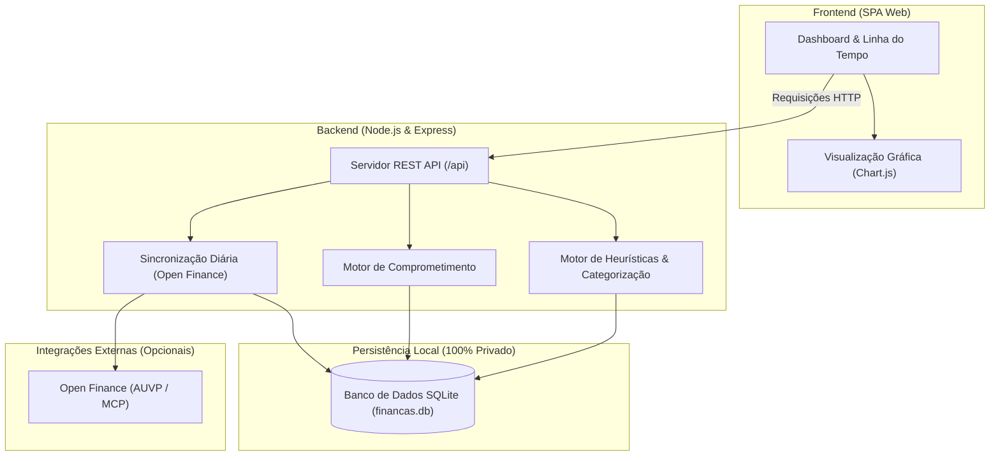

# Leftover Finance — Gestão Financeira Pessoal & Projeção de Sobra Real

<p align="center">
  
</p>

<p align="center">
  <strong>Sistema inteligente de fluxo de caixa, gestão de despesas fixas, antecipação de faturas de cartão de crédito e projeção de liquidez futura.</strong>
</p>

<p align="center">
  
  
  
  
  
  
</p>

---

## 📌 A Filosofia: "Sobra Real" vs "Saldo Ilusório"

A maioria dos aplicativos financeiros tradicionais mostra apenas o seu saldo bancário atual ou um gráfico do que você já gastou no passado. Isso cria uma ilusão de caixa: você tem R$ 5.000 na conta hoje, mas na próxima semana vencem R$ 4.000 em faturas de cartão e contas fixas.

O **Leftover Finance** foca no que realmente importa: **a sua Sobra Real**.
Ele calcula o fluxo de liquidez projetando o mês atual e meses futuros através de 4 camadas:

```
Liquidez Disponível = Saldo em Conta + Rendas Previstas
                     − Faturas de Cartão (correntes e compras parceladas)
                     − Despesas Fixas da Casa (aluguel, condomínio, luz, etc.)
                     − Parcelas Contratadas (empréstimos, financiamentos)
────────────────────────────────────────────────────────────────────────────
Sobra Real Livre     = O valor que você realmente tem disponível para poupar ou investir.
```

---

## 🚀 Funcionalidades Principais

### 1. 📊 Painel de Controle (Command Center)
- **Visão Instantânea de Liquidez:** Saldo real de contas correntes, faturas de cartão fechando/vencendo e previsão de saldo pós-faturas.
- **Card "Para Onde Vai Cada Real":** Distribuição proporcional exata da renda (Faturas de Cartão, Despesas Fixas, Parcelas de Dívidas e Variável) com indicador de pressão orçamentária.
- **Barra de Progresso Temporal do Mês:** Acompanhe o percentual do mês decorrido vs. ritmo de consumo da renda.

### 2. 💳 Inteligência de Faturas & Modelo de Parcelas
- **Identidade Única de Compras:** Compras parceladas existem uma única vez no sistema; a mesma compra vista em várias faturas é unificada sem duplicar valores.
- **Relógio de Faturas em Tempo Real:** Acompanhamento dinâmico de datas de corte (fechamento) e vencimento de cada cartão, aprendidos das faturas da AUVP (e ajustáveis em Configurar).
- **Calendário de Descompressão de Dívidas:** Projeção visual de quando cada parcela contratada termina, permitindo prever a recuperação da renda nos próximos meses.

### 3. 🏦 Open Finance pela AUVP (qualquer banco)
- **Sincronização automática:** contas, cartões, saldos, faturas oficiais e transações vêm do MCP da AUVP. Funciona com qualquer banco conectado lá; nenhum banco fica fixo no código.
- **Contas e cartões descobertos sozinhos:** cada conta ou cartão novo na AUVP aparece em Configurar, com fechamento e vencimento aprendidos das faturas.
- **Rendas sugeridas pelo histórico:** o app acha as entradas que se repetem e pergunta se são renda; cada uma pode ser fixa, por hora, variável (média dos últimos 3 meses) ou eventual, reconhecida pelo texto ou pelo valor do crédito.
- **Motor de Regras:** categorização e natureza financeira (`gasto`, `transferencia`, `transferencia-propria`, `salario`, `rendimento`, `ignorado`), com a categoria da AUVP quando nenhuma regra casa.

### 4. 🧭 Primeira vez guiada e uso na casa toda
- **Assistente:** cria usuário e senha, pede a chave da AUVP, confere cartões e rendas.
- **Só este computador ou casa toda:** no segundo caso, abre no celular pelo Wi-Fi, sempre com login.

### 5. 🔒 Privacidade Absoluta & Segurança de Chaves
- **100% Local:** Todo o armazenamento reside em um banco SQLite (`financas.db`) gerenciado pelo módulo nativo `node:sqlite`.
- **Zero Vazamento:** Extratos, senhas, planilhas e histórico financeiro são rigorosamente protegidos no `.gitignore`.
- **Chave da AUVP fora do banco:** fica num cofre local (no Windows, criptografada com DPAPI; no Linux/Docker, arquivo só do dono) ou em variável de ambiente, nunca no `financas.db` nem no git.

---

## 🏗️ Arquitetura do Sistema



---

## 📁 Estrutura do Projeto

```text
leftover-finance/
├── .gitignore               # Proteção estrita contra vazamento de dados pessoais
├── LICENSE                  # Licença MIT
├── README.md                # Documentação do projeto
└── app/
    ├── server.js            # Servidor Express & endpoints da API
    ├── db.js                # Inicialização e schemas SQLite (node:sqlite)
    ├── package.json         # Dependências do Node.js
    ├── Dockerfile           # Imagem conteinerizada de produção
    ├── docker-compose.yml   # App no Docker, aberto na rede de casa
    ├── .env.example         # Template de variáveis de ambiente
    ├── public/              # Frontend web estático
    │   ├── index.html       # Estrutura SPA (com o assistente da primeira vez)
    │   ├── entrar.html      # Criar acesso / entrar
    │   ├── style.css        # Tema e estilos customizados
    │   ├── app.js           # Lógica do frontend
    │   ├── chart.umd.js     # Biblioteca gráfica Chart.js
    │   └── logo.svg         # Identidade visual
    ├── core/                # Núcleo: sincronização AUVP, faturas, comprometimento, calendário
    │   ├── acesso.js        # Usuário e senha, sessão e "só este PC" ou "casa toda"
    │   ├── auvp-sync.js     # Contas, cartões, faturas e transações da AUVP
    │   ├── comprometido.js  # Motor único: faturas, contas, renda e sobra de cada mês
    │   ├── fontes.js        # Origem de cada transação (cartão ou conta)
    │   ├── rendas.js        # Rendas: reconhecimento, sugestões do histórico, média das variáveis
    │   └── segredo.js       # Cofre local da chave da AUVP
    └── scripts/             # Módulos de apoio
        ├── auvp-client.js   # Cliente MCP da AUVP
        ├── contas.js        # Contas e cartões (descobertos na AUVP)
        ├── conciliacao.js   # Reconciliar: pagamento × conta do mês
        ├── motor-regras.js  # Categorização automática
        ├── regras-seed.js   # Regras iniciais genéricas
        └── sync-diario.js   # Sincronização em segundo plano
```

---

## 💻 Instalação & Execução

> **Projeto pessoal, aberto como está.** Use por sua conta; não há suporte. Fork e ajustes são bem-vindos.

Você vai precisar de uma conta na **AUVP** com seus bancos e cartões conectados, e da **chave do MCP da AUVP** (começa com `auvp_`). O app só lê os dados; nada é pago ou transferido por ele.

### Opção 1: No seu computador (Node.js)

Pré-requisito: **Node.js 22.5+** (o app usa o `node:sqlite`, que vem no Node).

```bash
git clone https://github.com/EvanderLucena/leftover-finance.git
cd leftover-finance/app
npm install
npm start
```

Abra **`http://localhost:4321`**. Na primeira vez, o app:

1. pede um **usuário e senha** (uma conta só, guardada no próprio computador);
2. explica a AUVP e pede a **chave do MCP**, depois busca suas contas, cartões e transações;
3. mostra os cartões com o **dia de fechamento e de vencimento** aprendidos das faturas, para você conferir;
4. sugere as **rendas** a partir das entradas que se repetem no histórico (fixa, por hora, variável ou eventual);
5. pergunta **onde você vai usar**:
   - **Só neste computador**: o app só abre aqui (escuta em `127.0.0.1`).
   - **Na casa toda**: abre no celular e em outros aparelhos do mesmo Wi-Fi, com usuário e senha; o app mostra o endereço (ex.: `http://192.168.0.10:4321`). No Windows, permita o Node.js em **Redes privadas** quando o firewall perguntar.

Dá para trocar depois em **Configurar → Acesso**. Esqueceu a senha? No computador onde o app roda, rode `npm run nova-senha` na pasta `app`: o acesso é apagado (os dados ficam) e o app pede um novo na próxima vez.

### Opção 2: Docker (servidor em casa)

```bash
cd leftover-finance/app
docker compose up -d
docker compose logs app    # mostra o código de instalação
```

Abra `http://IP-DA-MÁQUINA:4321` e crie usuário e senha. Como o acesso não vem do próprio computador do app, a primeira tela pede o **código de instalação** que aparece no log. Os dados e o cofre da chave ficam em `app/data/`.

- Para abrir só na própria máquina, troque a linha `ports` do `docker-compose.yml` para `"127.0.0.1:4321:4321"`.
- Variáveis opcionais em `.env` (veja `.env.example`): `PORTA`, `FINANCA_ENDERECO` (endereço que o app mostra para o celular) e `AUVP_KEY`.

### Acesso de fora de casa

O app usa HTTP simples, pensado para a rede de casa. **Não abra a porta no roteador.** Para acessar da rua, use uma VPN como o [Tailscale](https://tailscale.com): instale no computador do app e no celular e abra o endereço do Tailscale na porta 4321.

---

## 🔑 Segurança

- **Senha do app**: guardada só como hash (scrypt). A sessão é um cookie `HttpOnly` de 90 dias; 5 senhas erradas seguidas bloqueiam aquele aparelho por 1 minuto.
- **Chave da AUVP**: fica no cofre local (`core/segredo.js`): no Windows, protegida pela sua conta de usuário (DPAPI); no Linux/Docker, em arquivo com permissão só do dono. Nunca vai para o banco de dados nem para as respostas da API, que só dizem se ela existe.
- **Dados financeiros**: ficam no SQLite local (`financas.db`), que o `.gitignore` nunca deixa entrar no Git.

---

## 🤝 Contribuições

Contribuições são bem-vindas! Sinta-se à vontade para abrir uma *Issue* para relatar problemas ou enviar um *Pull Request* com melhorias.

1. Faça um Fork do projeto
2. Crie uma branch para a sua feature (`git checkout -b feature/nova-funcionalidade`)
3. Faça o commit das suas alterações (`git commit -m 'feat: adiciona nova funcionalidade'`)
4. Faça o push para a branch (`git push origin feature/nova-funcionalidade`)
5. Abra um Pull Request

---

## 📄 Licença

Distribuído sob a licença **MIT**. Consulte o arquivo [`LICENSE`](LICENSE) para mais detalhes.

